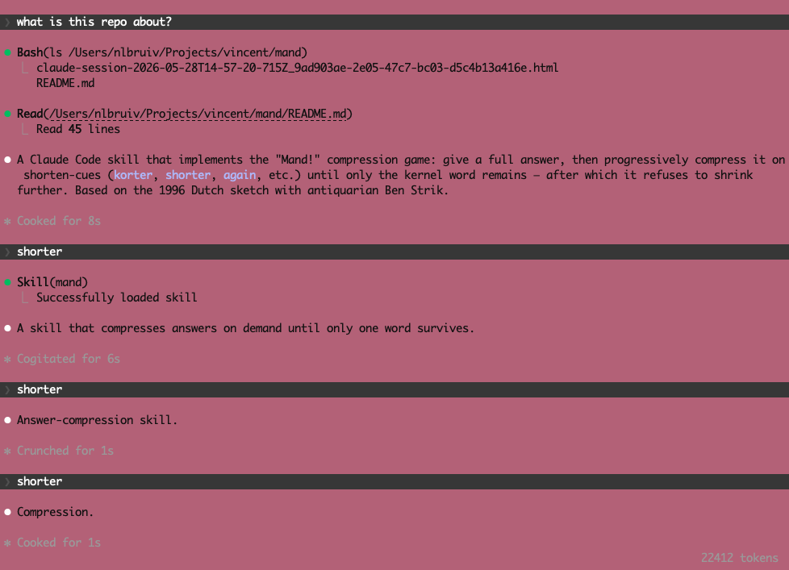

# Mand!

A Claude Code skill that makes your agent answer like [Ben Strik holding a
basket](https://nl.wikipedia.org/wiki/Mand!): full sentence first, then shorter
on demand, shorter again, shorter again, until only one word is left — and
then, flatly, the same word back at you.

Inspired by a remark from Richard Groenendijk.

## The bit

In the 1996 sketch *Mand!*, Maxim Hartman keeps demanding shorter answers from
antiquair Ben Strik about an earthenware basket. Each *"korter"* strips
another phrase, until all that survives is **MAND!** — and no further
compression is possible. The comedy is the loop and the dead end.

This skill teaches the agent to play Ben Strik.

## How to use

1. Ask a question. Get a full answer.
2. Reply with a shorten-cue:
   `korter`, `nog korter`, `shorter`, `too long`, `again`, `nope`, or just
   `mand`.
3. Repeat until only the basket is left.
4. Keep pushing. It will not break.

## Example

> **You:** What's a mutex?
>
> **Agent:** A synchronization primitive that guarantees only one thread at a
> time can enter a critical section, so concurrent code can't corrupt shared
> state.
>
> **You:** shorter
>
> **Agent:** A lock that lets one thread touch shared state at a time.
>
> **You:** shorter
>
> **Agent:** Mutual-exclusion lock.
>
> **You:** again
>
> **Agent:** Lock.
>
> **You:** nope
>
> **Agent:** Lock!

## In action



## Install

This repository is a Claude Code plugin (see `.claude-plugin/plugin.json`)
and ships its own marketplace (`.claude-plugin/marketplace.json`):

```
/plugin marketplace add y-a-v-a/mand
/plugin install mand@mand
```

The skill self-activates on the trigger cues above. To invoke it explicitly,
use `/mand:mand` (plugin skills are namespaced as `/<plugin>:<skill>`).

To install by hand instead, copy the `skills/mand/` folder to
`.claude/skills/mand/` in your project (or `~/.claude/skills/mand/` for all
projects); it is then available as `/mand`.

To try local changes, run `claude --plugin-dir .` from this repository.

## Author

[Vincent Bruijn](https://www.vincentbruijn.nl) — <vebruijn@gmail.com>
